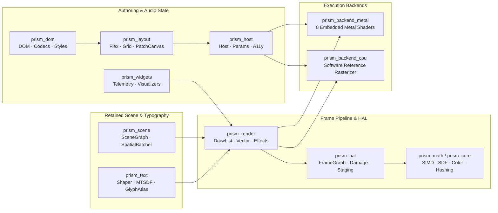
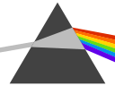

<p align="center">
  <picture>
    <source media="(prefers-color-scheme: dark)" srcset="assets/prism-header-dark.svg">
    <source media="(prefers-color-scheme: light)" srcset="assets/prism-header-light.svg">
    
  </picture>
</p>

<p align="center">
  A self-contained <strong>C++23</strong> GPU rendering engine, UI layout stack, and real-time audio visualization framework<br>
  built on a native <strong>Apple Metal</strong> backend and a deterministic <strong>CPU software reference</strong>.
</p>

<p align="center">
  <code>C++23</code> &nbsp;&middot;&nbsp;
  <code>Metal &amp; CPU Reference</code> &nbsp;&middot;&nbsp;
  <code>Zero External Dependencies</code> &nbsp;&middot;&nbsp;
  <code>macOS 13+ &amp; Linux</code>
</p>

<p align="center">
  <a href="#overview">Overview</a> &nbsp;&middot;&nbsp;
  <a href="#architecture">Architecture</a> &nbsp;&middot;&nbsp;
  <a href="#subsystems">Subsystems</a> &nbsp;&middot;&nbsp;
  <a href="#quick-start">Quick Start</a> &nbsp;&middot;&nbsp;
  <a href="#verification">Verification</a> &nbsp;&middot;&nbsp;
  <a href="#repository-structure">Structure</a>
</p>

---

## Overview

**PRISM** is engineered from the ground up with zero third-party dependencies for high-precision graphical interfaces, audio plugins, and modular instrument canvases. Every layer—from perceptual color math and analytical signed distance fields to OpenType text shaping, stylesheet resolution, and lock-free audio telemetry—is implemented cleanly in standard C++23 with strict cross-backend parity.

| Pillar | Design Highlights |
| :--- | :--- |
| **Dual-Backend Determinism** | Native **Metal** GPU shaders compiled and embedded at build time alongside a portable **CPU reference rasterizer**, built with `-ffp-contract=off` and cross-checked by pixel and polygon-clip coverage oracles. |
| **Analytical Primitives & Vector Engine** | 64-byte cache-aligned `PrimitiveDesc` uber-batching across 12 primitive kinds, tiled analytical vector path flattening and stroke expansion, Oklab/Oklch gradient ramps, and Gaussian, Dual-Kawase, backdrop blur, and bloom post-effects. |
| **DOM, Stylesheets & Modular Layout** | Generational-handle DOM with binary, XML, and JSON codecs plus live tree reconciliation; compiled CSS-like stylesheet cascade with 256-bit Bloom-filter rejection and rule provenance; Flexbox, Grid, Anchored, Tabbed, Scroll, and zoomable/dockable `PatchCanvas` solvers. |
| **Real-Time Audio & Host Integration** | Passive `CALayer` / portable surface host with lifecycle recovery, lock-free `ParameterMirror` with atomic dirty bitsets, 16&times;128 MIDI Learn slots, seqlock `PlayheadSnapshot`, ITU-R BS.1770 K-weighted LUFS + 4&times; true-peak metering, and GPU plot-strip visualizers. |

---

## Architecture

PRISM separates scene authoring, layout, frame scheduling, and hardware execution into clean, acyclic CMake static and interface libraries.



### Library Targets

| Target | Linkage | Responsibility |
| :--- | :--- | :--- |
| `prism_core` | Interface | Non-owning `FunctionRef`, `IntrusivePtr`, and strict `-ffp-contract=off` numeric flags |
| `prism_math` | Interface | `SimdVec`, affine 2D transforms, pixel snapping, sRGB / Display P3 / Oklab / Oklch radiometry, analytical shape & curve SDFs, Wang flattening, stem darkening, dithering, and `SpringCable` dynamics |
| `prism_hal` | Static | `FrameGraph` transient-texture heap aliasing, `DamageRegion` algebra, `DeviceRegistry`, `StagingRing`, buffer-age history, and surface health tracking |
| `prism_render` | Static | 64-byte `PrimitiveDesc`, `DrawList`, `UberBatches`, Oklab-aware `GradientTable`, tiled analytical vector engine (`VectorPath`, `StrokeExpander`, `PathTiler`, `FineRaster`), post-effects (`GaussianBlur`, `DualKawase`, `BackdropBlur`, `Bloom`), and build-time embedded Metal shaders |
| `prism_backend_cpu` | Static | Portable software reference rasterizer (`CpuRefBackend`, `CpuRaster`) |
| `prism_backend_metal` | Static *(Apple)* | Native Apple Metal device, surface, path engine, and post-effect pipelines (`Metal`, `Foundation`, `QuartzCore`) |
| `prism_text` | Static | From-scratch font parser, Unicode classes, UTF fast paths, Bidi, line breaking, OpenType layout, fallback-chain `TextShaper`, stem-darkened rasterizer, `MtsdfGenerator`, and tiered shelf-packed `GlyphAtlas` |
| `prism_scene` | Static | Retained `SceneGraph` (up to 65,536 nodes with 64-way hierarchical dirty bitsets and damage culling), `SpatialBatcher`, and `AnimationClock` |
| `prism_dom` | Static | Generational-handle `DomDocument`, binary / XML / JSON codecs, reconciler, and compiled `StyleResolver` with provenance tracking |
| `prism_layout` | Static | `LayoutEngine` unifying Flexbox, CSS Grid, Anchored, Tabbed, Scroll, `PatchCanvas`, and `Deck` solvers with physical-pixel snapping |
| `prism_host` | Static | `HostComponent`, `PassiveSurfaceHost` (AppKit/`CALayer` on macOS, portable elsewhere), `ParameterMirror`, `MidiLearnMapper`, `PlayheadSnapshot`, `ComponentProxy`, and `AccessibilityBridge` |
| `prism_widgets` | Static | Lock-free SPSC `TelemetryRing`, radix `Fft`, K-weighted LUFS & 4&times; true-peak `LoudnessMeter`, `GpuSpectrum` (with 128-row waterfall), `GpuScope` (with phosphor persistence), `GpuFilterCurve`, and `GpuLoudnessMeter` |

---

## Subsystems

### Analytical Rendering & Metal Shaders

All primitives compile down to a cache-line-aligned 64-byte `PrimitiveDesc` covering 12 primitive types (`roundedRect`, `squircle`, `circleArc`, `lineCapsule`, `quadBezier`, `triangle`, `boxShadow`, `glyphAlpha`, `glyphLcd`, `glyphMtsdf`, `texturedQuad`, and `plotStrip`) with five blend modes (`sourceOver`, `screen`, `multiply`, `additive`, `replace`) and linear, radial, or conic gradients.

<details>
<summary><strong>Embedded Metal Shader Library (8 shaders)</strong></summary>

Shaders under `shaders/metal/` are embedded into `ShaderSources.cpp` at configure/build time via `cmake/EmbedShaders.cmake`:

- `prism_common.metal` — Shared primitive descriptors, transforms, clips, and color utilities
- `prism_sdf.metal` — Analytical distance evaluators for shapes, superellipses, arcs, and quadratic Béziers
- `prism_shading.metal` — Coverage evaluation, gradient table sampling, and blending
- `uber_primitive.metal` — Batched uber-primitive vertex/fragment pipeline
- `vector_raster.metal` — GPU tiled vector path rasterization
- `post_effects.metal` — Gaussian blur, Dual-Kawase blur, backdrop blur, and bloom passes
- `present.metal` — Linear-to-display presentation with dithering
- `probes.metal` — GPU verification probes for analytical shadow and math validation

</details>

### Typography Pipeline

`prism_text` implements the complete text pipeline without external shaping or rasterization libraries: binary font parsing (`FontFile`), UTF-8 fast paths, Unicode bidirectional reordering (`Bidi`), line breaking, OpenType feature application (`OpenTypeLayout`), cached fallback-chain shaping (`TextShaper`), stem-darkened coverage rasterization, multi-channel signed distance fields (`MtsdfGenerator`), and a multi-page shelf-packed `GlyphAtlas` across seven height classes (`16`–`128` px) with LRU shelf eviction.

### Real-Time Audio Telemetry & Visualizers

Audio-thread communication is strictly lock-free and cache-line aligned:

- **`ParameterMirror`** — Atomic parameter values, gesture state, quantized plain/normalized conversions, and atomic 64-bit dirty bitmasks for UI polling.
- **`PlayheadSnapshot`** — Seqlock transport snapshot (`bpm`, `ppq`, time signature, playing/recording flags).
- **`MidiLearnMapper`** — Lock-free arm/bind routing across all 16 MIDI channels &times; 128 CC slots.
- **`TelemetryRing<T, N>`** — Single-producer, single-consumer power-of-two ring buffer with cache-line-padded read/write/drop counters.
- **GPU Visualizers** — `GpuSpectrum` (4096-point FFT + 128-row scrolling waterfall), `GpuScope` (hysteresis trigger + `PhosphorBuffer` decay), `GpuFilterCurve` (up to 16 cascaded biquad sections), and `GpuLoudnessMeter` (momentary, short-term, integrated LUFS, 4&times; true peak, and stereo RMS).

---

## Quick Start

### Prerequisites

- **CMake** `3.25` or newer and **Ninja**
- **C++23** compiler (Apple Clang on macOS `13.0+` with Metal/AppKit/QuartzCore, Clang or GCC on Linux, or MSVC on Windows)

### Bootstrap & Test

The bootstrap script configures `.githooks`, builds the selected preset, and runs the full CTest suite:

```sh
./scripts/bootstrap.sh headless
```

### CMake Presets

Presets are defined in `CMakePresets.json`:

| Preset | Build Type | Sanitizers | Notes |
| :--- | :--- | :--- | :--- |
| `headless` | `Debug` | Off | Default Ninja preset with `BUILD_TESTING=ON` and `compile_commands.json` |
| `sanitized` | `Debug` | ASan + UBSan | Enables `-fsanitize=address,undefined -fno-omit-frame-pointer` |
| `release` | `Release` | Off | Optimized release build with studio tooling stripped (`PRISM_ENABLE_STUDIO=OFF`) |
| `realtime` | `RelWithDebInfo` | RealtimeSanitizer | `-fsanitize=realtime` on telemetry and parameter hooks; bootstrap selects the Homebrew LLVM toolchain |
| `bench` | `Release` | Off | Adds `bench/prism_workloads` and the `bench`-labelled W1–W6 tests |
| `plugin` | `Release` | Off | Release configuration used for plugin builds |

Run configure, build, and test individually for any preset:

```sh
cmake --preset release
cmake --build --preset release
ctest --preset release
```

---

## Verification

PRISM enforces correctness, numerical fidelity, and repository hygiene automatically in both local tests and CI (`.github/workflows/check.yml`, running `headless`, `sanitized`, and `release` across `ubuntu-latest` and `macos-latest`):

- **CPU/GPU Parity Oracles** — `PixelOracle`, `CoverageOracle`, and `PolygonClipOracle` validate Metal GPU shaders against the CPU reference across uber-primitives, gradient dithering, vector rasterization, post-effects, shadows, typography, visualizers, and passive `CALayer` surfaces. Metal GPU tests exit with skip code `77` when executed on headless hardware without a GPU.
- **Device-Wide Path Scan** — `pathScan` uses 256-thread SIMD partitions and packed atomic look-back descriptors instead of one serial threadgroup. Ordered work tickets and recomputation of unpublished predecessor sums avoid GPU scheduling-dependent spin waits. The 30-bit descriptor payload bounds each path to 1,073,741,823 pieces; larger bounds are rejected before encoding. `path_scan` compares all offsets against an integer oracle across 52 zero, dense, random and sparse scans, including partition tails and 1,048,583 tiles. `vector_engine` additionally checks multi-partition even-odd coverage against the CPU rasterizer. These are correctness gates, not certification of the full 120 Hz frame pipeline.
- **Frame-Wide Vector Rasterization** — A 144-byte path record carries uniforms and GPU addresses for each path's working buffers. Four frame-wide compute dispatches perform counting, SIMD look-back scanning plus backdrop construction, scattering, and cooperative coverage rasterization. Per-path half-float coverage buffers are composited in scene order inside the primitive render pass, preserving clips, translucent overlap and primitive interleaving without per-path compute/render switches. Explicit barriers and indirect-resource declarations govern buffer visibility. `vector_engine` checks mixed-size batches, uneven scan partitions, clipping, sparse damage, fill rules and drawing order. Dense translucent stacks use a separate relative RGB RMS oracle because repeated half-float target writes accumulate rounding; single-coverage cases retain the existing maximum-error gate.
- **Asynchronous Metal Submission** — Each surface owns three upload-resource slots guarded by a monotonic `MTLSharedEvent`. `render()` submits without waiting for GPU completion; a busy ring skips submission and forces full damage on the next accepted frame. `lastSubmitted()` distinguishes those cases, while GPU timing and fragment counts describe the newest completed frame. Readback, resize, device loss and destruction explicitly drain queued work. `frame_pipeline` checks burst-frame ownership and resize/rebuild recovery against CPU output. Native `renderToLayer()` encodes scene work and late-latched presentation in one command buffer; presentation counts only acquired drawables. Live-resize transaction presentation retains its required scheduling wait. The persistent scene texture still incurs a presentation pass; direct scene-to-swapchain rendering and 120 Hz timing certification remain incomplete.
- **Linear Display P3 Swapchain** — Native layers use immutable `RGBA16Float`, extended-linear Display P3, display synchronization and three framebuffer-only drawables. A render-pass presentation shader converts premultiplied linear sRGB to linear Display P3 without gamma encoding or HDR clipping. Drawable size and device change only when needed. `presentation` checks primaries, translucent colors, negative extended values and HDR against the CPU transform; `passive_surface` exercises actual window presentation and recovery. Eight-bit sRGB export retains its separate dithered readback path.
- **Unified Spectral Compute** — Spectrograms and surfaces share the device command queue. A surface encodes pending FFT and prefix-integral work for referenced native textures before drawing in the same command buffer. `prepare()` exposes pending native texture views without waiting; repeated partial updates before encoding coalesce into a full rebuild. Explicit `dispatch()` remains synchronous for offline computation. Spectrogram preparation, rendering and destruction are confined to the owning render thread. `spectrogram_gpu` compares both explicit dispatch and integrated first-use/update results against the CPU estimator.
- **Hardware Frame Clock** — `PassiveSurfaceHost::startFrameClock()` delivers display target timestamps on the main thread through a non-owning `FrameTick` callback. macOS 14+ uses the view-associated `CADisplayLink` with a preferred 60–120 Hz range; macOS 13 uses `CVDisplayLink` and a coalescing main-runloop source rather than dispatching heap-backed blocks. `preferLegacy` exercises the fallback explicitly. Stop or detach invalidates either clock before releasing its context; callers must stop the clock before destroying callback state. `frame_clock` verifies monotonic timestamps, main-thread delivery, stop/restart and detach for both paths. This verifies native pacing integration, not a 120 Hz presentation-jitter bound.
- **Presentation Pacing Limits** — Native presentation uses `afterMinimumDuration:max(0, displayPeriod - 0.0005)` with the period supplied by the active display link. Presentation-rate and performance certification require measurements on the specification's target hardware. Those release gates remain open.
- **Allocation Guard** — `AllocGuard` verifies zero unexpected heap allocations across hot-path unit tests.
- **Strict Compiler & Lint Gates** — Compiled with `-Wall -Wextra -Wpedantic -Werror` (`/W4 /WX` on MSVC), formatted with LLVM-style `.clang-format` (4-space indent, 100-column width), and checked for comment-free source files:

```sh
cmake --build --preset headless --target lint
```

### Workload Benchmarks

`bench/prism_workloads W1`…`W6` renders the six specification workloads at 2560&times;1440 and reports order-statistic Q50/Q99 with Welford moments for host encode, GPU time, draw calls and upload bytes. Each run exits non-zero when an absolute gate fails:

```sh
cmake --preset bench && cmake --build --preset bench
ctest --preset bench -L bench --output-on-failure
```

W1 and W2 include CPU scene recording and Metal encoding in host timing and explicitly drain each offscreen submission before sampling GPU duration, so asynchronous submission cannot turn dropped work into a passing measurement. W2 measures 10,000 post-warmup frames and counts allocations across recording and encoding, including driver C++ allocations. These offscreen completion times are not display presentation intervals. GPU timing and allocation gates remain unfulfilled; driver allocations are not excluded from the gate.

Opaque-core, source-over, multiply and LCD fragment entry points request early depth testing explicitly. Primitive and typography GPU parity tests pass with this enabled. Correctness tests alone do not certify performance.

`scripts/ci/verify_all.sh` runs every preset, the benchmark label, the commit-message audit and, when `PRISM_PLUGIN_VALIDATOR` and `PRISM_PLUGIN_ARTIFACTS` are set, plugin validation at strictness level 10. It lists skipped steps and fails on any red gate.

---

## Repository Structure

```text
PRISM/
├── assets/                 Vector brand marks and adaptive README headers
├── cmake/                  Build-time shader embedding script (EmbedShaders.cmake)
├── bench/                  W1–W6 workload benchmarks and statistics reporting
├── scripts/                Bootstrap and verify_all certification scripts
├── shaders/metal/          Native Apple Metal shaders (8 .metal modules)
├── src/
│   ├── core/               FunctionRef, IntrusivePtr
│   ├── math/               SIMD, SDFs, color spaces, dithering, curve flattening, springs
│   ├── hal/                FrameGraph, DamageRegion, DeviceRegistry, StagingRing
│   ├── render/             DrawList, UberBatches, GradientTable, vector/, effects/
│   ├── backends/           cpu/ software reference & metal/ native GPU backend
│   ├── text/               Font parser, Bidi, OpenType shaper, MTSDF, GlyphAtlas
│   ├── scene/              Retained SceneGraph, SpatialBatcher, AnimationClock
│   ├── dom/                DOM tree, binary/XML/JSON codecs, StyleResolver, layout/
│   ├── host/               HostComponent, PassiveSurfaceHost, ProcessorState, A11y
│   ├── telemetry/          TelemetryRing, Fft, LoudnessMeter
│   └── widgets/            GpuSpectrum, GpuScope, GpuFilterCurve, GpuLoudnessMeter
├── tests/
│   ├── unit/               30+ deterministic unit & allocation-guard test suites
│   ├── gpu/                Metal GPU parity, visualizers, and passive-surface tests
│   └── support/            AllocGuard, PixelOracle, CoverageOracle, reference scenes
└── tools/lint/             Source comment scanner and commit-message policy verifier
```

---

<p align="center">
  
</p>
